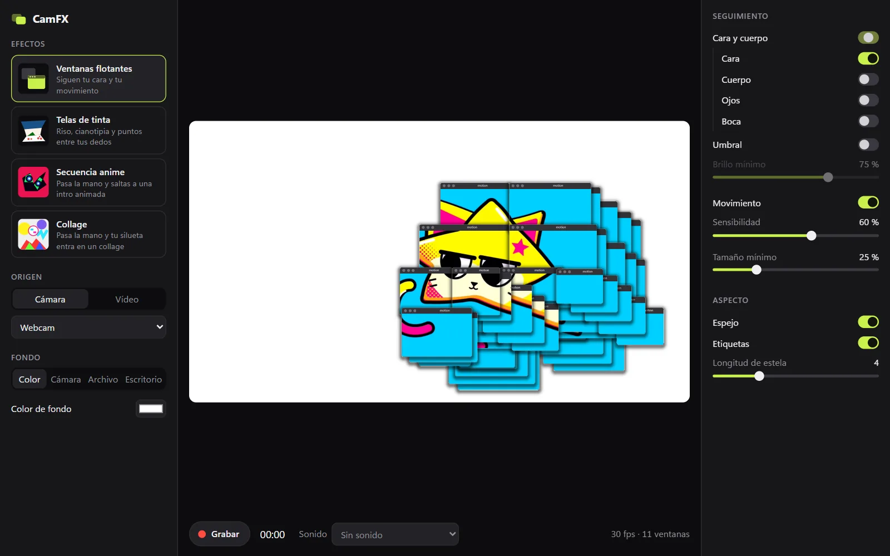

# CamFX

Efectos en directo para tu cámara en Windows. Detecta tu cara, tus manos y tu movimiento, y los convierte en efectos que puedes grabar.



## Descargar

Baja `CamFX_x.y.z_x64.exe` de la [última versión](https://github.com/Emb003es/CamFX/releases/latest) y ábrelo. Es un solo archivo, sin instalador.

- Probada en Windows 11. Usa WebView2, que ya viene con Windows 11.
- Necesita una cámara o un vídeo H.264.
- No va firmado, así que Windows SmartScreen puede avisar la primera vez.

## Qué hace

- **Ventanas flotantes:** pone sobre tu cara y tu movimiento ventanas que dejan ver ese trozo de la cámara, con estela. Pueden flotar sobre tu escritorio.
- **Telas de tinta:** tres telas tensadas entre los dedos de tus dos manos: cianotipia, riso y puntos. Cada una hace de lente.
- **Secuencia anime:** un barrido de mano te mete en una intro animada con tu silueta dentro. Otro barrido te saca.
- **Collage:** el mismo gesto, pero tu silueta entra en un collage de polígonos que cambia 8 veces por segundo.
- **Fondo:** color, imagen, vídeo o tu escritorio.
- **Grabar:** MP4 H.264 a 1920x1080 y 12 Mbps en `Vídeos\CamFX`, con sonido opcional del micro.

## Privacidad

Todo se procesa en tu PC: la app no se conecta a ningún servidor. MediaPipe intenta mandar estadísticas de uso a Google, y CamFX lo bloquea en `web/tracker.worker.js` y con la política de seguridad de sus páginas.

## Limitaciones conocidas

- No abre los vídeos HEVC del iPhone. Solo H.264.
- Las ventanas no se pueden arrastrar.
- Al grabar el escritorio, graba siempre el primer monitor.

## Desarrollar

Hace falta Rust estable, Visual Studio Build Tools con C++ y WebView2.

```bash
cd src-tauri
cargo run --release
```

Tests de la lógica:

```bash
node --test test/logic.test.js
```

## Cómo funciona por dentro

- **Stack:** Tauri 2, WebGL y MediaPipe Tasks Vision. La interfaz es HTML y JavaScript sin compilar.
- **Ventanas:** son falsas. Es una sola capa transparente a pantalla completa, dibujada con WebGL de una vez. Con ventanas reales de Windows iría mucho peor.
- **Detección:** va en un hilo aparte que nunca acumula fotogramas. El dibujo sigue a la cámara, no a la pantalla.
- **Rendimiento:** con Ventanas flotantes en una GTX 1660 Ti, a 1080p y 30 fps: 0,6 ms de dibujo por fotograma, unos 12 ms de detección, 4,7 % de CPU y 13 % de GPU.

```
src-tauri/   App Tauri: ventanas, capa del escritorio y grabación
web/         Interfaz y efectos: panel, overlay, logic, seq, webs y tracker.worker
web/vendor/  MediaPipe y sus modelos
test/        Tests de la lógica
```

## Créditos

Los efectos están inspirados en trabajos de otros creadores, reescritos desde cero, sin su código ni sus imágenes:

- Ventanas flotantes: efecto original de @lo.fi.sci.fi, [visto en un reel de DJ_Dave](https://www.instagram.com/reel/DdjqhjPhkm7/).
- Telas de tinta: [reel de william](https://www.instagram.com/reel/DZINqLuOhiD/).
- Secuencia anime y Collage: reels de Epoh, [anime](https://www.instagram.com/reel/DfMqB_5iG_y/) y [collage](https://www.instagram.com/reel/DdJVasTjZ7Q/).

## Licencia

[MIT](LICENSE). MediaPipe y las demás dependencias tienen sus propias licencias: ver [THIRD_PARTY_NOTICES.md](THIRD_PARTY_NOTICES.md).
